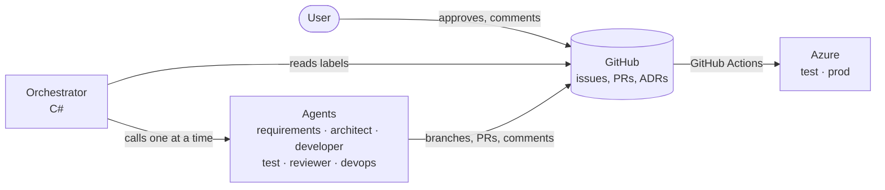
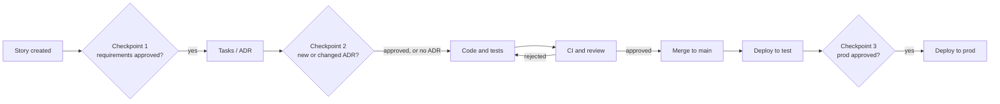

# Agent system – design

> How Football Game Planner is built: six AI agents and a deterministic orchestrator.

## Summary

Six AI agents build the app story by story, driven by a deterministic orchestrator written in C#. GitHub is the single source of truth, and the user approves at three checkpoints.

- **The orchestrator is plain code, not an AI.** It moves stories between steps by fixed rules, so the flow is predictable, testable and cheap.
- **GitHub holds everything:** stories are issues, code is pull requests, decisions are ADR files in the repository. The agents have no hidden memory; everything is visible and reviewable.
- **The user approves requirements, architecture and production deployment.** Everything else runs automatically but stops if the agents get stuck.
- **The agents never reach production or real personal data.** Deployment happens only through GitHub Actions, and prod requires the user's approval.
- **Inputs:** the [product brief](brief.md), the [GDPR analysis](gdpr.md) and the clickable prototype.
- **Language:** the agents write code, comments, commits, issues, pull requests and documentation in English. Only text shown to users in the app is Swedish.

## Overview



The orchestrator calls one agent at a time and stores every result in GitHub. GitHub Actions builds, tests and deploys; the agents never touch Azure directly.

## The agents

Each agent has a narrow responsibility, its own instructions (a prompt file in the repository) and only the tools its job requires.

| Agent | Responsibility | Input | Output | Tools | Model |
| --- | --- | --- | --- | --- | --- |
| Requirements | Turns the brief into user stories with acceptance criteria | Brief, GDPR analysis, prototype | GitHub issues with Given–When–Then criteria and GDPR ids | Read documents, create issues | Claude Opus 5.5 |
| Architect | Architecture, data model and task breakdown | Approved stories, existing code | ADR files, architecture document, task list per story | Read the repository, write in docs/ | Claude Opus 5.5 |
| Developer | Implements a story | Story, ADRs, affected code | Branch with code and unit tests, pull request | Read and write files, run dotnet build and test | Claude Sonnet 5.5 |
| Test | Writes integration and E2E tests from the acceptance criteria | Story, pull request | Tests in the same pull request | Read and write tests, run tests | Claude Sonnet 5.5 |
| Reviewer | Reviews against the story, ADRs, GDPR requirements and security | Diff, story, test results | Approval or change request on the pull request | Read the repository, comment on pull requests | Claude Opus 5.5 |
| DevOps | Maintains CI/CD and infrastructure as code | Architecture, environment requirements | GitHub Actions workflows, Bicep files | Read and write .github/ and infra/ | Claude Sonnet 5.5 |

The test agent sees the story and the code but not the developer agent's reasoning. That way it tests against the requirements, not against how the code happened to be written.

## Orchestration

The orchestrator reads each story's status from labels on its issue and calls the next agent. It keeps no database of its own: if it is stopped, it resumes wherever GitHub says the work stands.



Checkpoint 2 applies only when a story needs a new or changed architecture decision. Ordinary stories go straight from tasks to code.

## Checkpoints and escalation

The user approves at three points and is called in automatically when the agents get stuck.

| Checkpoint | When | How the user approves |
| --- | --- | --- |
| 1. Requirements | When the requirements agent has created or changed stories | Adds the `approved` label to the issue, or comments with changes |
| 2. Architecture | When a new or changed ADR is proposed | Merges the pull request containing the ADR |
| 3. Production | When main is to be released to prod | Approves the deployment in the GitHub environment `prod` |

**Escalation.** The orchestrator stops a story and asks the user for help when:

- the reviewer has rejected the same pull request three times
- the tests have failed three times in a row
- an agent wants to change something outside its permissions, for example an ADR or infra/
- a story has used up its token budget

The user can always read and comment on pull requests. The agents read the user's comments as instructions in the next round.

## Permissions and safeguards

The agents may write code but can never get past the safeguards that protect main, production and personal data.

**The agents may**

- create branches, commits, issues and pull requests in the FootballGamePlanner repository, through a GitHub App with access to that repository only
- run dotnet build and tests in an isolated container, where only NuGet is reachable from the internet
- read everything in the repository and write within their own area (see the agent table)

**The agents may never**

- push directly to main; main requires a pull request and green CI
- hold Azure credentials; deployment happens only through GitHub Actions with OIDC
- deploy to prod; that requires the user's approval in the GitHub environment `prod`
- read the production database or production logs; all test data is invented (see the GDPR analysis)
- see secrets; they live in GitHub Secrets and Azure Key Vault and are never sent in a prompt
- change their own instructions, ADRs, CI rules or repository settings without going through the user's checkpoint

**Protection against manipulation.** The agents take instructions only from the orchestrator and from the user's comments. Text in issues, code or dependencies that looks like instructions is treated as data.

## Repository, branches and environments

One repository holds the app, the agent system, the infrastructure and the documentation. Main is always deployable.

```
FootballGamePlanner/
  src/
    FootballGamePlanner.Web/            Blazor web app, mobile-first PWA
    FootballGamePlanner.Domain/         domain model and the suggestion algorithm
    FootballGamePlanner.Infrastructure/ database (EF Core) and sign-in
  tests/
    FootballGamePlanner.Domain.Tests/
    FootballGamePlanner.Web.Tests/
    FootballGamePlanner.E2E/            Playwright tests of the core flow (added later)
  agents/
    FootballGamePlanner.Agents/         orchestrator and agents (C#, build step 2)
    prompts/                            one instruction file per agent
  infra/                                Bicep files for Azure (build step 5)
  docs/
    brief.md  gdpr.md  agent-system.md  architecture.md
    adr/                                architecture decisions, one per file
  .github/workflows/                    ci.yml, deploy.yml
```

- **Branches:** main is protected. Each story gets a branch, `story/<number>-<short-name>`, and a pull request.
- **Merging:** when CI is green and the reviewer has approved, the pull request is merged automatically. For the first stories the user also reviews and merges each pull request, until the reviewer agent has proven reliable.
- **Branch protection:** set by the user in GitHub's repository settings: pull request required, the `Build and test` check required and up to date, no force pushes or deletions. No approving review is required, because pull requests are opened under the user's own account and GitHub does not let an author approve their own pull request.
- **Environments:**
  - dev: locally on the user's computer or in the agent's container
  - test: Azure, deployed automatically from main, invented data only
  - prod: Azure Sweden Central, deployed when the user has approved

## Test strategy and definition of done

The suggestion algorithm is the core of the app and is tested hardest. It must prove its rules on thousands of randomly generated matches, not just on a few examples.

| Level | What | Tools |
| --- | --- | --- |
| Unit | Domain logic and the algorithm | xUnit |
| Property-based | The algorithm's rules hold for every squad and setup: the right number on the pitch, no player twice, substitutions only in windows, the smallest possible difference in playing time, the same input gives the same suggestion | FsCheck |
| Integration | API, database, access per team | xUnit and Testcontainers |
| E2E | The core flow from the prototype, at phone size | Playwright |
| Accessibility | Contrast, labels, keyboard | axe via Playwright |

**Definition of done for a story**

- every acceptance criterion has at least one passing test
- CI is green: build, all tests, code analysis and dependency check
- the reviewer agent has approved against the story, ADRs and GDPR requirements
- no new player data beyond what the GDPR analysis allows
- deployed to test, with E2E tests green there
- documentation updated if behaviour changed

## Technology, cost and logging

The agent system is a C# console app built on Anthropic's official C# SDK, without frameworks that hide what the agents do.

- **Agent loop:** each agent is a loop of calls to Claude with tools (tool use). The orchestrator runs the tools, for example reading a file, writing a file or running tests, and sends the results back.
- **GitHub access:** through Octokit and a GitHub App with access to the FootballGamePlanner repository only.
- **Isolation:** the developer and test agents work in a Docker container with a clone of the repository.
- **Model choice:** Opus for requirements, architecture and review, where judgement matters most. Sonnet for code, tests and CI, where the volume is largest.
- **Cost control:** each story has a token budget, and the Anthropic account has a monthly cap. The brief, ADRs and GDPR requirements are cached in the prompt, since they are sent with almost every call.
- **Traceability:** every run is logged with agent, story, tool calls, tokens and outcome. The orchestrator writes a short summary as a comment on the issue or pull request, so the user can see what happened without reading logs.

## Build order

The system is built one agent at a time, and each step must work end to end before the next is added.

1. **Foundation:** GitHub repository, protection of main, CI that builds an empty .NET solution, and the brief and GDPR analysis as files in docs/.
2. **Orchestrator and requirements agent:** the requirements agent creates user stories as issues. The user approves them (checkpoint 1).
3. **Architect agent:** the first ADRs on stack, data model and sign-in. The user approves (checkpoint 2).
4. **Developer, test and reviewer agents:** they build the first thin story, "Leader signs in and creates a team", through the whole loop.
5. **DevOps agent:** Bicep and deployment to test, then prod with the user's approval (checkpoint 3).
6. **Backlog:** the suggestion algorithm early, because it carries the most risk, then the rest of the core flow in the prototype's order.

## Decisions and open questions

- [x] The orchestrator runs locally on the user's computer first, later as a scheduled GitHub Actions job
- [x] The app is called Football Game Planner; the repository is JWeiderberg/FootballGamePlanner on the user's personal GitHub account
- [x] The user's existing Anthropic API key is used, stored only as a local secret; the monthly cap starts low and is raised once the real cost per story is measured
- [x] The user reviews and merges pull requests for the first stories personally, until the reviewer agent has proven reliable
- [x] Everything in the repository is in English; only the app's user interface is Swedish
- [ ] A new Azure subscription will be created (by build step 5). Open: monthly budget for test and prod
