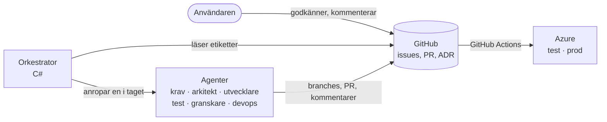
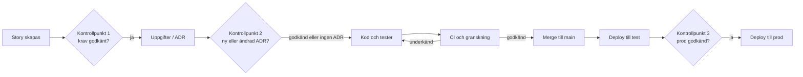

# Agentsystemet – design

> Hur Football Game Planner byggs: sex AI-agenter och en deterministisk orkestrator. Dokumentet är skrivet på svenska.

## Sammanfattning

Sex AI-agenter bygger appen story för story, styrda av en deterministisk orkestrator i C#. GitHub är den enda källan till sanning, och användaren godkänner vid tre kontrollpunkter.

- **Orkestratorn är vanlig kod, inte en AI.** Den flyttar stories mellan steg enligt fasta regler, så flödet blir förutsägbart, testbart och billigt.
- **GitHub håller allt:** stories är issues, kod är pull requests, beslut är ADR-filer i repot. Agenterna har inget dolt minne; allt syns och kan granskas.
- **Användaren godkänner krav, arkitektur och produktionsdeploy.** Allt annat går automatiskt men stoppas om agenterna fastnar.
- **Agenterna når aldrig produktion eller riktiga personuppgifter.** Deploy sker bara via GitHub Actions, och prod kräver användarens godkännande.
- **Indata:** [produktbriefen](brief.md), [GDPR-analysen](gdpr.md) och prototypen.

## Översikt



Orkestratorn anropar en agent i taget och sparar allt resultat i GitHub. GitHub Actions bygger, testar och deployar; agenterna rör aldrig Azure direkt.

## Agenterna

Varje agent har ett smalt ansvar, egna instruktioner (en prompt-fil i repot) och bara de verktyg uppgiften kräver.

| Agent | Ansvar | Indata | Utdata | Verktyg | Modell |
| --- | --- | --- | --- | --- | --- |
| Krav | Gör om briefen till user stories med acceptanskriterier | Brief, GDPR-analys, prototyp | GitHub-issues med kriterier i Givet–När–Så-form och GDPR-id:n | Läsa dokument, skapa issues | Claude Opus 5.5 |
| Arkitekt | Arkitektur, datamodell och uppdelning i uppgifter | Godkända stories, befintlig kod | ADR-filer, arkitekturdokument, uppgiftslista per story | Läsa repot, skriva i docs/ | Claude Opus 5.5 |
| Utvecklare | Implementerar en story | Story, ADR:er, berörd kod | Branch med kod och enhetstester, pull request | Läsa och skriva filer, köra dotnet build och test | Claude Sonnet 5.5 |
| Test | Skriver integrations- och E2E-tester från acceptanskriterierna | Story, pull request | Tester i samma pull request | Läsa och skriva tester, köra tester | Claude Sonnet 5.5 |
| Granskare | Granskar mot story, ADR:er, GDPR-krav och säkerhet | Diff, story, testresultat | Godkännande eller ändringsbegäran i pull requesten | Läsa repot, kommentera pull requests | Claude Opus 5.5 |
| DevOps | Underhåller CI/CD och infrastruktur som kod | Arkitektur, miljökrav | GitHub Actions-flöden, Bicep-filer | Läsa och skriva .github/ och infra/ | Claude Sonnet 5.5 |

Test-agenten ser story och kod men inte utvecklar-agentens resonemang. Då testar den mot kraven, inte mot hur koden råkade bli skriven.

## Orkestrering

Orkestratorn läser varje storys status från etiketter på issuen och anropar nästa agent. Den håller ingen egen databas: stängs den av fortsätter den där GitHub säger att arbetet står.



Kontrollpunkt 2 gäller bara när en story kräver ett nytt eller ändrat arkitekturbeslut. Vanliga stories går direkt från uppgifter till kod.

## Kontrollpunkter och eskalering

Användaren godkänner vid tre punkter och kallas in automatiskt när agenterna fastnar.

| Kontrollpunkt | När | Hur användaren godkänner |
| --- | --- | --- |
| 1. Krav | När krav-agenten skapat eller ändrat stories | Sätter etiketten godkänd på issuen, eller kommenterar ändringar |
| 2. Arkitektur | När en ny eller ändrad ADR föreslås | Godkänner pull requesten med ADR-filen |
| 3. Produktion | När main ska ut i prod | Godkänner i GitHub-miljön prod |

**Eskalering.** Orkestratorn stoppar en story och ber användaren om hjälp när:

- granskaren underkänt samma pull request tre gånger
- testerna fallerat tre gånger i följd
- en agent vill ändra något utanför sin behörighet, till exempel en ADR eller infra/
- en story har förbrukat sin tokenbudget

Användaren kan alltid läsa och kommentera pull requests. Agenterna läser användarens kommentarer som instruktioner nästa runda.

## Behörigheter och skydd

Agenterna får skriva kod men aldrig ta sig förbi de spärrar som skyddar main, produktion och personuppgifter.

**Agenterna får**

- skapa branches, commits, issues och pull requests i repot FootballGamePlanner, via en GitHub App med behörighet till just det repot
- köra dotnet build och tester i en isolerad container, där bara NuGet nås från nätet
- läsa allt i repot och skriva inom sitt eget område (se tabellen över agenter)

**Agenterna får aldrig**

- pusha direkt till main; main kräver pull request, grön CI och godkänd granskning
- ha inloggningsuppgifter till Azure; deploy sker bara via GitHub Actions med OIDC
- deploya till prod; det kräver användarens godkännande i GitHub-miljön prod
- läsa produktionsdatabas eller produktionsloggar; all testdata är påhittad (GDPR-analysen)
- se hemligheter; de ligger i GitHub Secrets och Azure Key Vault och skickas aldrig i en prompt
- ändra sina egna instruktioner, ADR:er eller CI-regler utan att det går via användarens kontrollpunkt

**Skydd mot manipulation.** Agenterna tar bara instruktioner från orkestratorn och från användarens kommentarer. Text i issues, kod eller beroenden som ser ut som instruktioner behandlas som data.

## Repo, branches och miljöer

Ett repo håller appen, agentsystemet, infrastrukturen och dokumentationen. Main är alltid deploybar.

```
FootballGamePlanner/
  src/
    FootballGamePlanner.Web/            Blazor-webbapp, mobilanpassad PWA
    FootballGamePlanner.Domain/         domänmodell och förslagsalgoritmen
    FootballGamePlanner.Infrastructure/ databas (EF Core) och inloggning
  tests/
    FootballGamePlanner.Domain.Tests/
    FootballGamePlanner.Web.Tests/
    FootballGamePlanner.E2E/            Playwright-tester av kärnflödet (läggs till senare)
  agents/
    FootballGamePlanner.Agents/         orkestrator och agenter (C#, byggsteg 2)
    prompts/                            en instruktionsfil per agent
  infra/                                Bicep-filer för Azure (byggsteg 5)
  docs/
    brief.md  gdpr.md  agentsystem.md  arkitektur.md
    adr/                                arkitekturbeslut, ett per fil
  .github/workflows/                    ci.yml, deploy.yml
```

- **Branches:** main är skyddad. Varje story får en branch, `story/<nummer>-<kort-namn>`, och en pull request.
- **Sammanslagning:** när CI är grön och granskaren godkänt slås pull requesten ihop automatiskt. För de första storyna krävs dessutom användarens godkännande, tills granskar-agenten visat sig pålitlig.
- **Miljöer:**
  - dev: lokalt på användarens dator eller i agentens container
  - test: Azure, deployas automatiskt från main, bara påhittad data
  - prod: Azure Sweden Central, deployas när användaren godkänt

## Teststrategi och definition of done

Förslagsalgoritmen är appens kärna och testas hårdast. Den ska bevisa sina regler på tusentals slumpade matcher, inte bara på några exempel.

| Nivå | Vad | Verktyg |
| --- | --- | --- |
| Enhet | Domänlogik och algoritmen | xUnit |
| Egenskapsbaserade | Algoritmens regler gäller för alla trupper och upplägg: rätt antal på planen, ingen spelare två gånger, byten bara i bytesfönster, minsta möjliga skillnad i speltid, samma indata ger samma förslag | FsCheck |
| Integration | API, databas, behörighet per lag | xUnit och Testcontainers |
| E2E | Kärnflödet från prototypen, i mobilstorlek | Playwright |
| Tillgänglighet | Kontrast, etiketter, tangentbord | axe via Playwright |

**Definition of done för en story**

- alla acceptanskriterier har minst ett test som går igenom
- CI är grön: bygge, alla tester, kodanalys och beroendekontroll
- granskar-agenten har godkänt mot story, ADR:er och GDPR-kraven
- inga nya spelaruppgifter utöver dem GDPR-analysen tillåter
- deployad till test och E2E-testerna gröna där
- dokumentationen uppdaterad om beteendet ändrats

## Teknik, kostnad och loggning

Agentsystemet är en C#-konsolapp byggd på Anthropics officiella C#-SDK, utan ramverk som döljer vad agenterna gör.

- **Agentloop:** varje agent är en loop av anrop till Claude med verktyg (tool use). Orkestratorn kör verktygen, till exempel läsa fil, skriva fil eller köra tester, och skickar tillbaka resultatet.
- **GitHub-åtkomst:** via Octokit och en GitHub App med behörighet till bara repot FootballGamePlanner.
- **Isolering:** utvecklar- och test-agenten arbetar i en Docker-container med en klon av repot.
- **Modellval:** Opus för krav, arkitektur och granskning, där omdöme väger tyngst. Sonnet för kod, tester och CI, där volymen är störst.
- **Kostnadskontroll:** varje story har en tokenbudget och varje körning ett månadstak hos Anthropic. Briefen, ADR:erna och GDPR-kraven cachas i prompten, eftersom de skickas med i nästan varje anrop.
- **Spårbarhet:** varje körning loggas med agent, story, verktygsanrop, tokens och utfall. Orkestratorn skriver en kort sammanfattning som kommentar på issuen eller pull requesten, så att användaren ser vad som hänt utan att läsa loggar.

## Byggordning

Systemet byggs en agent i taget, och varje steg ska fungera från början till slut innan nästa läggs till.

1. **Grundplattan:** GitHub-repo, skydd av main, CI som bygger en tom .NET-lösning, och briefen och GDPR-analysen som filer i docs/.
2. **Orkestratorn och krav-agenten:** krav-agenten skapar user stories som issues. Användaren godkänner dem (kontrollpunkt 1).
3. **Arkitekt-agenten:** första ADR:erna om stack, datamodell och inloggning. Användaren godkänner (kontrollpunkt 2).
4. **Utvecklar-, test- och granskar-agenten:** de bygger den första tunna storyn, "Ledare loggar in och skapar ett lag", genom hela loopen.
5. **DevOps-agenten:** Bicep och deploy till test, sedan prod via användarens godkännande (kontrollpunkt 3).
6. **Backloggen:** förslagsalgoritmen tidigt, eftersom den har störst risk, därefter resten av kärnflödet i prototypens ordning.

## Beslut och öppna frågor

- [x] Orkestratorn körs först lokalt på användarens dator, senare som ett schemalagt GitHub Actions-jobb
- [x] Appen heter Football Game Planner och repot JWeiderberg/FootballGamePlanner på användarens personliga GitHub-konto
- [x] Användarens befintliga Anthropic API-nyckel används, sparad bara som lokal hemlighet; månadstaket sätts lågt och höjs när verklig kostnad per story är mätt
- [x] Användaren granskar och godkänner själv pull requests för de första storyna, tills granskar-agenten visat sig pålitlig
- [ ] En ny Azure-prenumeration skapas (senast i byggsteg 5). Öppet: månadsbudget för test och prod
